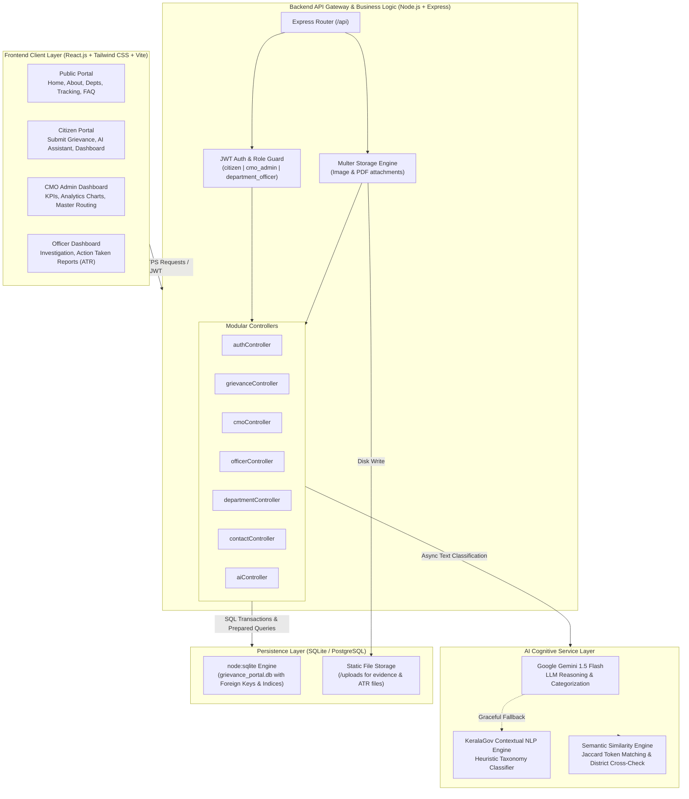
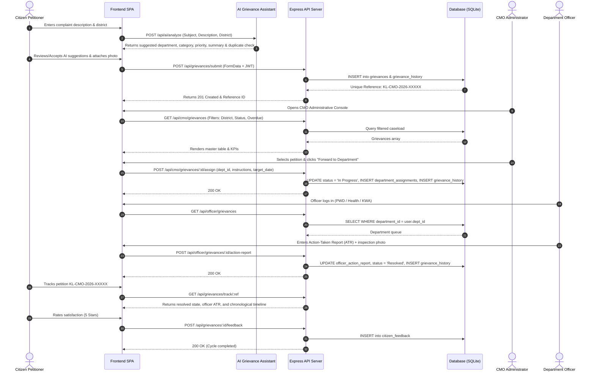

# 02. System Architecture

## Architecture Overview
The CM Kerala Public Grievance Redressal Portal is architected following the **Three-Tier Enterprise Web Application Pattern** with an asynchronous **AI Cognitive Layer**:

---

## 1. Technology Stack Breakdown

| Tier | Technology | Specification / Version | Rationale |
| :--- | :--- | :--- | :--- |
| **Frontend** | React.js | v18.3.1 + Vite 5.4 | High-performance Single Page Application with instantaneous reactive re-rendering. |
| **Styling** | Tailwind CSS | v3.4 | Consistent Government of Kerala design system with royal emerald, gold, and accessible slate palettes. |
| **Charts** | Recharts | v2.12 | Responsive vector SVG charts for district-wise, department-wise, and status distributions. |
| **Icons** | Lucide React | v0.441 | Lightweight, accessible SVG iconography. |
| **Backend** | Node.js + Express | Node v24.17 + Express 4.21 | Asynchronous non-blocking I/O event loop, enterprise modular routing and middleware pipelining. |
| **Database** | SQLite via `node:sqlite` | Built-in Node 24 Native SQLite | Zero external native compilation overhead, synchronous prepared statements, acid transactions, foreign key enforcement, and instant portability across environments. Compatible with PostgreSQL via Prisma/Sequelize. |
| **Auth** | JWT + BCrypt | `jsonwebtoken` + `bcryptjs` | Stateless cryptographic bearer token authentication with role-based authorization (RBAC) and 10-round salted password hashing. |
| **File Handling** | Multer | v1.4.5-lts | Multipart form file streaming with mime-type validation (JPG, PNG, WEBP, PDF, DOCX up to 10MB). |
| **AI Integration** | Google Gemini + Heuristic NLP | Gemini 1.5 Flash + Contextual Heuristic Classifier | Dual-engine design: Calls cloud LLM when API key is provided, with a zero-dependency contextual NLP fallback engine ensuring 100% offline uptime. |

---

## 2. Security Architecture

1. **Role-Based Access Control (RBAC)**:
   - `citizen`: Can submit petitions, view own grievances, rate resolved petitions, and reopen them.
   - `cmo_admin`: Full executive oversight; can view all 14 districts, assign line departments, escalate delayed petitions, and approve resolutions.
   - `department_officer`: Strictly scoped to petitions forwarded to their specific department ID (e.g. PWD officer cannot access Health grievances).
2. **Stateless Authentication**:
   - Access tokens are cryptographically signed with HS256 algorithm and a configurable `JWT_SECRET`. Tokens expire after 7 days.
3. **Audit Trail Logging**:
   - Every status transition is written to `grievance_history` inside atomic database transactions, capturing `from_status`, `to_status`, `action`, `performed_by_id`, `performed_by_name`, `performed_by_role`, and `timestamp`.
4. **Input Sanitization & Injection Prevention**:
   - All database interactions use prepared statements (`stmt.run(?, ?)`, `stmt.all(...)`), eliminating SQL injection vulnerabilities.
   - File uploads are validated by MIME type, sanitized to alphanumeric filenames, and served via controlled static routes.

---

## 3. End-to-End Workflow Data Flow

