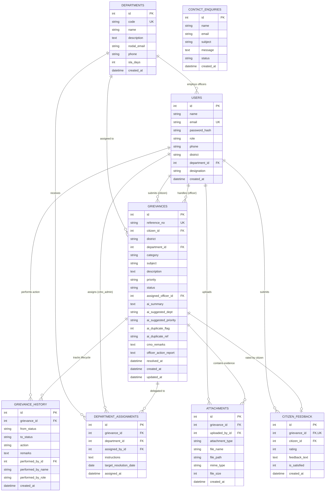

# 03. Database Design

## Database Schema & Entity Relationship Design
The database architecture supports complete relational integrity, full lifecycle tracking, role separation, departmental assignments, and attachments.

---

## 1. Entity-Relationship (ER) Diagram

---

## 2. Table Specifications & Data Dictionaries

### 2.1 `departments`
Stores integrated Kerala Government administrative bodies.
- `id` (INTEGER, PK, Auto Increment)
- `code` (TEXT, UNIQUE, NOT NULL): Department short code (e.g. `PWD`, `HEALTH`, `KSEB`, `KWA`, `LSGD`, `REVENUE`, `CIVIL_SUPPLIES`, `EDUCATION`, `POLICE`).
- `name` (TEXT, NOT NULL): Official title (e.g. "Public Works Department (PWD)").
- `description` (TEXT): Administrative purview and scope.
- `nodal_email` (TEXT): Official nodal contact email.
- `phone` (TEXT): Helpdesk or emergency landline number.
- `sla_days` (INTEGER, DEFAULT 14): Statutory resolution deadline in days.
- `created_at` (DATETIME, DEFAULT CURRENT_TIMESTAMP)

### 2.2 `users`
Supports role-based authorization for citizens, CMO executives, and departmental field officers.
- `id` (INTEGER, PK, Auto Increment)
- `name` (TEXT, NOT NULL): Full legal name.
- `email` (TEXT, UNIQUE, NOT NULL): Case-insensitive unique login identifier.
- `password_hash` (TEXT, NOT NULL): 10-round salted BCrypt hash.
- `role` (TEXT, CHECK: `citizen`, `cmo_admin`, `department_officer`): Access tier.
- `phone` (TEXT): Primary contact phone number.
- `district` (TEXT): Residential district (for citizens) or posting jurisdiction (for officers).
- `department_id` (INTEGER, NULLABLE, FK &rarr; `departments(id)`): Foreign key for departmental officers.
- `designation` (TEXT): Official bureaucratic rank (e.g. "Principal Secretary to CM", "Executive Engineer PWD").
- `created_at` (DATETIME, DEFAULT CURRENT_TIMESTAMP)

### 2.3 `grievances`
Central registry of citizen petitions submitted to the Chief Minister.
- `id` (INTEGER, PK, Auto Increment)
- `reference_no` (TEXT, UNIQUE, NOT NULL): Format `KL-CMO-2026-XXXXX`.
- `citizen_id` (INTEGER, NOT NULL, FK &rarr; `users(id)`): Submitting citizen.
- `district` (TEXT, NOT NULL): One of the 14 Kerala districts where the issue occurred.
- `department_id` (INTEGER, NULLABLE, FK &rarr; `departments(id)`): Assigned department.
- `category` (TEXT, NOT NULL): Specific public domain taxonomy.
- `subject` (TEXT, NOT NULL): Concise title/summary of the issue.
- `description` (TEXT, NOT NULL): Full narrative complaint text.
- `priority` (TEXT, DEFAULT 'Medium', CHECK: `Low`, `Medium`, `High`, `Urgent`): Operational triage level.
- `status` (TEXT, DEFAULT 'Submitted', CHECK: `Submitted`, `Under Review`, `In Progress`, `Resolved`, `Reopened`): Lifecycle stage.
- `assigned_officer_id` (INTEGER, NULLABLE, FK &rarr; `users(id)`): Assigned investigating officer.
- `ai_summary` (TEXT): AI-generated executive briefing for CMO.
- `ai_suggested_dept` (TEXT): Department classification output by AI.
- `ai_suggested_priority` (TEXT): Urgency recommendation output by AI.
- `ai_duplicate_flag` (INTEGER, DEFAULT 0): 1 if similarity threshold exceeded with an existing complaint.
- `ai_duplicate_ref` (TEXT, NULLABLE): Reference number of the matching duplicate complaint.
- `cmo_remarks` (TEXT, NULLABLE): Instructions issued by the Chief Minister's Office.
- `officer_action_report` (TEXT, NULLABLE): Official Action-Taken Report (ATR) from line department.
- `resolved_at` (DATETIME, NULLABLE): Timestamp of final resolution sign-off.
- `created_at` (DATETIME, DEFAULT CURRENT_TIMESTAMP)
- `updated_at` (DATETIME, DEFAULT CURRENT_TIMESTAMP)

### 2.4 `grievance_history`
Immutable audit log tracking every status transition, user action, and remark.
- `id` (INTEGER, PK, Auto Increment)
- `grievance_id` (INTEGER, NOT NULL, FK &rarr; `grievances(id)` ON DELETE CASCADE)
- `from_status` (TEXT, NULLABLE): Previous status.
- `to_status` (TEXT, NOT NULL): New status.
- `action` (TEXT, NOT NULL): Semantic action verb (e.g. "Citizen Submitted", "Assigned by CMO", "Officer Investigation Update", "Action Taken Report Submitted", "Citizen Feedback Submitted", "Citizen Reopened").
- `remarks` (TEXT): Action description or directives.
- `performed_by_id` (INTEGER, NULLABLE, FK &rarr; `users(id)`)
- `performed_by_name` (TEXT): Name of actor for tamper-proof history.
- `performed_by_role` (TEXT): Role of actor.
- `created_at` (DATETIME, DEFAULT CURRENT_TIMESTAMP)

### 2.5 `department_assignments`
Formal administrative routing records from the CMO to line departments.
- `id` (INTEGER, PK, Auto Increment)
- `grievance_id` (INTEGER, NOT NULL, FK &rarr; `grievances(id)` ON DELETE CASCADE)
- `department_id` (INTEGER, NOT NULL, FK &rarr; `departments(id)`)
- `assigned_by_id` (INTEGER, NOT NULL, FK &rarr; `users(id)`)
- `instructions` (TEXT): Secretarial directives.
- `target_resolution_date` (DATE): SLA compliance deadline.
- `assigned_at` (DATETIME, DEFAULT CURRENT_TIMESTAMP)

### 2.6 `attachments`
Stores uploaded photographic evidence, inspection reports, and official documents.
- `id` (INTEGER, PK, Auto Increment)
- `grievance_id` (INTEGER, NULLABLE, FK &rarr; `grievances(id)` ON DELETE CASCADE)
- `uploaded_by_id` (INTEGER, NULLABLE, FK &rarr; `users(id)`)
- `attachment_type` (TEXT, CHECK: `citizen_evidence`, `officer_report`, `cmo_attachment`)
- `file_name` (TEXT, NOT NULL): Original upload filename.
- `file_path` (TEXT, NOT NULL): Relative storage path (e.g. `/uploads/pothole_marampally-173184.jpg`).
- `mime_type` (TEXT): Verified MIME type (`image/jpeg`, `application/pdf`, etc.).
- `file_size` (INTEGER): File size in bytes.
- `created_at` (DATETIME, DEFAULT CURRENT_TIMESTAMP)

### 2.7 `citizen_feedback`
Citizen satisfaction rating and verification upon case closure.
- `id` (INTEGER, PK, Auto Increment)
- `grievance_id` (INTEGER, UNIQUE, NOT NULL, FK &rarr; `grievances(id)` ON DELETE CASCADE)
- `citizen_id` (INTEGER, NOT NULL, FK &rarr; `users(id)`)
- `rating` (INTEGER, NOT NULL, CHECK: 1 to 5): Star satisfaction rating.
- `feedback_text` (TEXT): Qualitative remarks.
- `is_satisfied` (INTEGER, DEFAULT 1): 1 for satisfied, 0 for unsatisfied.
- `created_at` (DATETIME, DEFAULT CURRENT_TIMESTAMP)

### 2.8 `contact_enquiries`
Public enquiries submitted via the public contact form.
- `id` (INTEGER, PK, Auto Increment)
- `name` (TEXT, NOT NULL)
- `email` (TEXT, NOT NULL)
- `subject` (TEXT, NOT NULL)
- `message` (TEXT, NOT NULL)
- `status` (TEXT, DEFAULT 'Pending', CHECK: `Pending`, `Answered`, `Archived`)
- `response` (TEXT, NULLABLE)
- `created_at` (DATETIME, DEFAULT CURRENT_TIMESTAMP)

---

## 3. Performance Indices
To ensure high-throughput query response times under high concurrency:
- `CREATE INDEX idx_grievances_ref ON grievances(reference_no);`
- `CREATE INDEX idx_grievances_citizen ON grievances(citizen_id);`
- `CREATE INDEX idx_grievances_dept ON grievances(department_id);`
- `CREATE INDEX idx_grievances_status ON grievances(status);`
- `CREATE INDEX idx_grievances_district ON grievances(district);`
- `CREATE INDEX idx_history_grievance ON grievance_history(grievance_id);`
