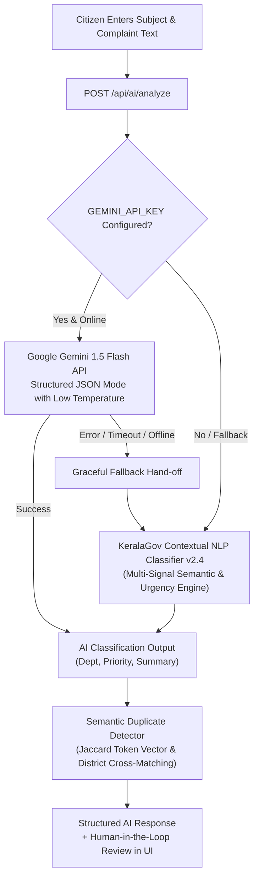

# 05. AI Integration & Cognitive Assistant

## Overview
The **AI Grievance Assistant** automates the triaging, summarization, and duplicate detection of incoming citizen petitions for the Chief Minister's Office (CMO).

---

## 1. Dual-Engine Architecture
To satisfy the requirements of high reasoning quality while guaranteeing 100% offline uptime and zero-dependency portability, the system implements a **Dual-Engine Strategy**:



1. **Primary Cloud Engine: Google Gemini 1.5 Flash**:
   - High-speed inference (sub-500ms).
   - Structured JSON output mode with deterministic low temperature (`0.2`).
   - Deep contextual comprehension of bilingual Malayalam-English expressions (e.g., "pokkuvaravu", "pattayam", "culvert", "chaliyar", "taluk").
2. **On-Premise Resilience Engine: KeralaGov Contextual NLP Classifier v2.4**:
   - Zero-dependency built-in heuristic classifier.
   - Evaluates multi-signal keyword matrices, domain synonym vectors, and linguistic severity indicators.
   - Guarantees zero downtime even during cloud outages or air-gapped deployments.

---

## 2. Gemini Prompt Architecture & System Instructions

When `GEMINI_API_KEY` is provided, the backend issues an HTTPS REST call to `v1beta/models/gemini-1.5-flash:generateContent`:

```text
You are the AI Grievance Classification Assistant for the Chief Minister's Office (CMO) Government of Kerala.
Analyze the following public grievance petition submitted by a citizen:

---
Subject: {{subject}}
Description: {{description}}
District: {{district}}
---

Available Kerala Government Departments:
1. Public Works Department (PWD) - roads, bridges, potholes, public buildings
2. Health & Family Welfare Department - hospitals, medicines, doctors, epidemics
3. Local Self Government Department (LSGD) - garbage, sewage, streetlights, panchayat, municipality
4. Kerala State Electricity Board (KSEB) - electricity, poles, transformers, power outages
5. Kerala Water Authority (KWA) - drinking water, pipeline leaks, water contamination
6. Revenue & Land Records Department - land survey, pokkuvaravu, mutation, pattayam
7. Food & Civil Supplies Department - ration cards, supplyco, PDS, black marketing
8. General & Higher Education Department - schools, teachers, midday meals, exams
9. Kerala Police & Public Safety - law and order, traffic, crime, vigilance petitions

Respond strictly with valid JSON only in this format:
{
  "suggestedDepartment": "Full Department Name",
  "suggestedDepartmentCode": "PWD | HEALTH | LSGD | KSEB | KWA | REVENUE | CIVIL_SUPPLIES | EDUCATION | POLICE",
  "suggestedCategory": "Specific Category Name",
  "suggestedPriority": "Low | Medium | High | Urgent",
  "summary": "Concise 1-2 sentence executive summary for the Chief Minister's Office."
}
```

---

## 3. Duplicate Complaint Detection Algorithm
To prevent administrative congestion caused by repeated submissions of the same ongoing issue (e.g. multiple residents reporting the same pothole or burst pipe), the system runs an automatic duplicate detector:

1. **Token Extraction**:
   - Extracts alphanumeric tokens of length &ge; 4 from `subject` and `description`.
   - Normalizes to lowercase and strips punctuation.
2. **Jaccard Similarity Calculation**:
   $$\text{Jaccard}(A, B) = \frac{|A \cap B|}{|A \cup B|}$$
3. **District Correlation Factor**:
   - If both complaints originate in the same district, similarity is weighted by $1.25\times$.
4. **Threshold Trigger**:
   - If similarity $\ge 40\%$ with an open or recently resolved complaint, the system flags the petition with:
     ```json
     {
       "isDuplicate": true,
       "similarityScore": 78,
       "matchedRef": "KL-CMO-2026-00101",
       "warning": "Potential duplicate complaint detected! High semantic overlap (78%) with ongoing petition KL-CMO-2026-00101."
     }
     ```

---

## 4. Priority Recommendation Matrix

The AI computes priority dynamically based on hazard severity and vulnerability:

| Priority | Trigger Factors | Action SLA |
| :--- | :--- | :--- |
| **Urgent** | Threat to human life, live hanging electric wires, acute snake venom/insulin shortage, collapsed culvert, mass drinking water contamination. | **24–48 Hours** |
| **High** | Multi-household water supply cutoff, deep road craters causing accidents, hospital doctor absence, severe drainage flooding into homes. | **5–7 Days** |
| **Medium** | Routine road resurfacing request, delay in land mutation (pokkuvaravu), streetlights non-functional, ration card address amendment. | **10–14 Days** |
| **Low** | General administrative feedback, public amenity suggestions, routine procedural clarifications. | **14–21 Days** |

---

## 5. Human-in-the-Loop Safeguards & Ethical Boundaries

Under Kerala Government digital governance principles:
1. **No Autonomous Decisions**:
   - AI predictions **never** directly close, reject, or officially decide a grievance.
   - All AI suggestions (department, category, priority, summary) are presented in the UI with a prominent "Apply AI Recommendations" button, allowing the citizen or administrator to inspect, override, or manually edit any field.
2. **Transparent Engine Labeling**:
   - The UI displays the active inference engine (e.g. `Google Gemini 1.5 Flash` or `KeralaGov Contextual NLP Classifier v2.4 (On-premise Heuristic Engine)`).
3. **Privacy & Anonymization**:
   - Prompts sent to LLM APIs contain only the grievance text, district, and subject. Citizen personal identifiers (phone numbers, email addresses, aadhaar or home address) are excluded from AI model ingestion.

---

## 6. Documented Limitations & Mitigations

| Limitation | Impact | Mitigation Strategy |
| :--- | :--- | :--- |
| **Network Latency / Cloud Outage** | External LLM API calls could fail or time out. | Handled via `try/catch` block that seamlessly falls back to the local contextual NLP engine without dropping user input. |
| **Local Colloquial Expressions** | Dialects (e.g., Valluvanadan vs Travancore Malayalam transliterations) might confuse generic models. | The local taxonomy engine includes regional Kerala administrative terms (`pokkuvaravu`, `pattayam`, `chaliyar`, `supplyco`, `panchayat`). |
| **Ambiguous Grievances** | Petitions spanning multiple departments (e.g. road digging by KWA affecting PWD road). | CMO Administrator retains master re-assignment controls in the CMO console. |
